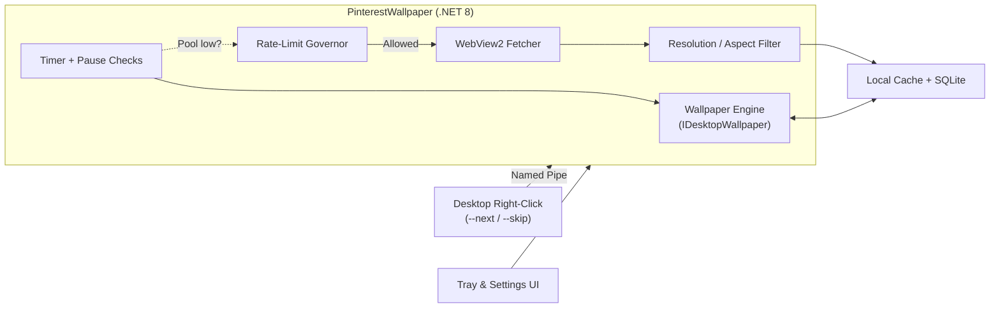

# Architecture

The app splits **instant offline wallpaper switching** from **occasional background syncing** so it feels native and stays gentle on Pinterest.

## Components

- **Wallpaper Engine (`IDesktopWallpaper`):** Applies cached images per-monitor with smooth transitions and fit modes. Keeps history so **Previous** works.
- **Right-Click Menu + Named Pipe IPC:** `HKCU\Software\Classes\DesktopBackground\Shell` runs the app with flags (`--next`, `--prev`, `--open-pin`, `--skip`), which forwards the command over a local Named Pipe to the running instance and exits immediately.
- **WebView2 Fetcher:** Uses a dedicated local WebView2 profile in `%LOCALAPPDATA%\PinterestWallpaper\WebView2`. You sign in once normally; background refills load only configured boards/searches/feed and pick full-res `originals` URLs.
- **Rate-Limit Governor:** Enforces cooldowns (default 4h), daily sync cap (default 4/day), randomized delays between steps, 1-at-a-time image downloads, and exponential backoff on `429` or login/challenge pages.
- **Image Filter & Cache:** Checks real pixel dimensions, orientation, aspect ratio, and duplicates before saving to the cache. Evicts oldest shown (non-favorited) images when hitting `maxCacheMb`.
